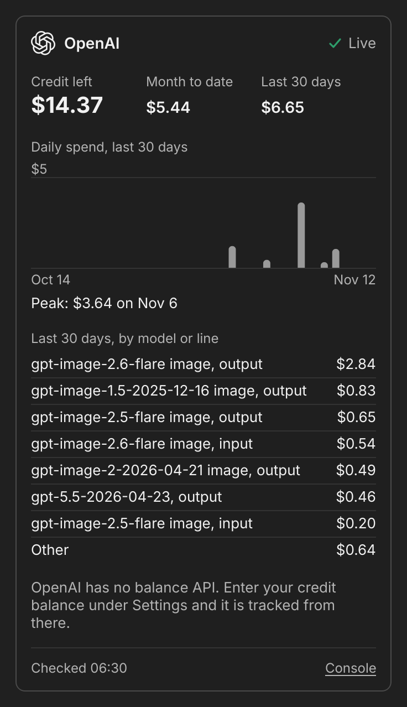

# Fumes

**Know before you're running on fumes.** A slim strip over the Windows 11 taskbar that shows what is
left on each of your AI accounts: the prepaid balance on every API provider, and how much of your
Claude subscription's 5-hour and weekly windows you have used.


> **Status: pre-release.** Fumes reads DeepSeek, OpenAI, fal.ai and the Anthropic API with your own
> keys, kept in Windows Credential Manager. A Settings window, a details window and a Windows
> installer are being built before the first release; until then keys are added from the command line.

## What it shows

- **Two rows, like the taskbar clock.** Providers sit two to a column, each a logo and its balance
  (or `mtd $6.10`, month-to-date spend, for a provider with no balance; an en dash when neither is
  known).
- **Claude limits.** The leftmost cell: `5h` above `wk`, each a small bar that fills from the left.
  The colour is the reading: green while there is room, yellow around half, red near the cap. Hover
  for the percentages and reset times.
- **Peeks.** Click a provider for its peek: credit left, month to date, the last 30 days, a daily
  spend chart, the spend by model, and links to that provider's console. Click another provider to
  switch; anywhere else (or Esc) closes it.

  
- **Trust at a glance.** A cell at full strength is live. A dimmed one is stale or failing, with its
  age shown when the whole strip is out of date.
- **Out of the way.** The chevron folds the strip down to just the Claude cell. Right-click for Move
  (drag it along the taskbar), Collapsed, Refresh now, Start with Windows, Restart and Quit.

## Download (Windows 11)

Get `Fumes-<version>-windows-x64.zip` from the [Releases](https://github.com/dsqr84/fumes/releases)
page, unzip it anywhere you like (for example `%LOCALAPPDATA%\Programs\Fumes`) and run `Fumes.exe`.
The folder also holds `fumes-cli.exe`, the command-line version, used for `fumes-cli key set ...`,
`fumes-cli doctor` and Claude Code's status line.

**Check what you downloaded.** Each release has a `.sha256` file:
`Get-FileHash Fumes-<version>-windows-x64.zip` in PowerShell must print the same value. Releases are
built on GitHub's own runners from the tagged source by
[`.github/workflows/release.yml`](.github/workflows/release.yml), with a build provenance
attestation you can check with `gh attestation verify <zip> --repo dsqr84/fumes`. The programs are
not code-signed, so Windows SmartScreen may warn the first time: choose **More info**, then **Run
anyway**, only for a file whose checksum you have checked.

## Install and run from source (Windows 11, Python 3.11+)

```
git clone https://github.com/<owner>/fumes.git
cd fumes
py -m venv .venv
.venv\Scripts\pip install -r requirements.txt
.venv\Scripts\pythonw -m fumes
```

Use `python -m fumes` instead of `pythonw` to see errors on the console. Starting Fumes again
replaces the copy that is already running.

## Add your keys

Each provider needs its own key; [`fumes/guides/`](fumes/guides/) says which kind and where to
create it. **Read [Keeping your keys safe](fumes/guides/key-safety.md) first:** some of these are Admin
keys, which can manage your whole account, not just read it. Until the Settings window lands, from the Fumes folder:

```
.venv\Scripts\python -m fumes key set openai        # asks for the key; nothing is shown or saved to a file
.venv\Scripts\python -m fumes anchor openai 25.00   # OpenAI and Anthropic: the credit your billing page shows
.venv\Scripts\python -m fumes key list              # which providers have a key (never the key itself)
.venv\Scripts\python -m fumes collect               # ask every provider once and print the result
.venv\Scripts\python -m fumes status               # what is set up, in a table (add --json for scripts)
.venv\Scripts\python -m fumes doctor               # checks each step, says what to fix, never prints a key
```

`fumes doctor` ends with the exact `statusLine` entry to add to Claude Code's settings if you use the
Claude limits cell. Neither `status` nor `doctor` ever prints a key or any part of one.

**Set up with an AI assistant.** Paste the prompt from [`docs/SETUP-WITH-AI.md`](docs/SETUP-WITH-AI.md)
(also `fumes setup-prompt`, or **Copy setup prompt** in Settings, General) into Claude Code or another
assistant that can run commands. It walks you through each provider, but **your keys are never given to
the assistant**: it runs `fumes key set`, and you paste each key into that hidden prompt yourself.

In **Claude Code**, the same steps come as skills: they load by themselves when you open Claude Code in
the Fumes folder, or install them anywhere with

```
/plugin install fumes --marketplace dsqr84/fumes
```

then ask Claude to "set up Fumes" (the `fumes-setup` skill) or to add a service Fumes does not support
(`fumes-add-provider`).

Keys are generic credentials named `Fumes/<provider>` in Windows Credential Manager, readable only by
your Windows account. Fumes sends each one only to that provider's own API, over HTTPS.

**Any other service** can be added in Settings with **Add provider**: a *manual* one (you enter the
balance, optionally with a daily burn) or a *command* one (a small program of yours that prints a
balance as JSON; [`fumes/guides/command.md`](fumes/guides/command.md) has the contract and a prompt
for having an AI write it). To build one into Fumes for everyone, see
[`docs/ADDING-A-PROVIDER.md`](docs/ADDING-A-PROVIDER.md) and [`CONTRIBUTING.md`](CONTRIBUTING.md).

**Claude limits** come from Claude Code on the same computer. If it is installed, Fumes asks it every
five minutes (`claude -p /usage`: a local command, no model call, no cost), which also gives the
per-model weekly limit shown as a blue bar. Setting Claude Code's status line to
`python -m fumes.statusline` (see [`fumes/guides/claude.md`](fumes/guides/claude.md)) adds a reading
after every answer while you work. `limits_poll_minutes = 0` turns the asking off.

## Configure

Settings live in `%APPDATA%\fumes\config.toml`; every key is optional (see
[`config.example.toml`](config.example.toml)). Your own logo for a provider can go in
`%APPDATA%\fumes\logos\<id>.svg` or `.png`. Window position, the collapsed state and the last
good readings are kept in `state.json` in the same folder.

- `url`, `limits_url`: an optional remote feed and Claude limits document, used instead of the
  built-in collectors and the local status-line file when set. `limits_url` can also be set in
  Settings, Claude limits; Settings changes only that one line of the file.
- `providers`: which providers to show, in order.
- `anchor`: `tray` (default, left of the notification area), `left` or `right`.
- `theme`: `auto` (follows Windows), `dark` or `light`.
- `[links]`: the console page opened from each provider's peek (http/https only). Links open in
  Chrome when it is installed (`browser = "default"` uses the system browser).

**Start with Windows** (in the menu) writes `HKCU\Software\Microsoft\Windows\CurrentVersion\Run\Fumes`,
which starts Fumes with the same Python and from the same folder it runs from now. If you move the
folder or rebuild the virtual environment, untick and tick it again.

## Develop

```
python3 -m venv .venv && .venv/bin/pip install -r requirements-dev.txt
QT_QPA_PLATFORM=offscreen .venv/bin/python -m pytest
QT_QPA_PLATFORM=offscreen .venv/bin/python -m fumes --once-png out.png --feed-file tests/sample-feed-live.json \
    --limits-file tests/sample-limits.json --theme dark --dpr 2
```

`--once-png` renders the strip (or `--peek <id>`, `--collapsed`, `--hover <id>`) to a PNG without a
taskbar, so most of the UI can be developed and tested off Windows. How the code fits together, and
what can only be checked on Windows, is in [`docs/ARCHITECTURE.md`](docs/ARCHITECTURE.md).

## Credits and licence

Fumes is free software under the [GNU General Public License v3.0](LICENSE).

- Font: [Inter](https://rsms.me/inter/) 4.1 by Rasmus Andersson, SIL Open Font License 1.1
  ([`fumes/fonts/LICENSE-Inter.txt`](fumes/fonts/LICENSE-Inter.txt)).
- Provider logos: [@lobehub/icons](https://github.com/lobehub/lobe-icons) 1.102.0, MIT licence. The
  logos and names are trademarks of their owners; Fumes is not affiliated with or endorsed by any of
  them.
