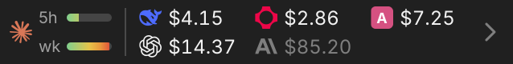

# Fumes

**Know before you're running on fumes.** A slim strip over the Windows 11 taskbar that shows what
is left on your AI accounts:

- the prepaid balance on each API provider
- how much of your Claude subscription's 5-hour and weekly limits you have used



> **Status: first release (v0.1.0), Windows 11 only.** Fumes reads DeepSeek, OpenAI, fal.ai and the
> Anthropic API with your own keys, kept in Windows Credential Manager. The download is a zip:
> there is no installer yet, and the programs are not code-signed.

## Get started

1. **Download and run.** Unzip the release and run `Fumes.exe` ([Download](#download-windows-11)).
2. **Add a key.** Right-click the strip, choose **Settings**, pick a provider and paste its key
   ([Add your keys](#add-your-keys)). OpenAI and Anthropic need an Admin key: read
   [About Admin keys](#about-admin-keys) first.
3. **Read the strip.** The balance appears beside the provider's logo. Claude limits appear by
   themselves when Claude Code is signed in on this computer.

## What it shows

- **Balances, in two rows.** Providers sit two to a column, like the taskbar clock. Each shows its
  logo and balance. A provider with no balance shows its spend for the month so far, as
  `mtd $6.10`. An en dash means neither is known.
- **Claude limits.** The leftmost cell: `5h` above `wk`, each a small bar that fills from the left.
  The colour is the reading: green while there is room, yellow around half, red near the cap. Hover
  for the percentages and reset times.
- **A closer look.** Click a provider to open its peek, a small panel with the credit left, the
  month to date, the last 30 days, a daily spend chart, the spend by model, and links to that
  provider's console. Click another provider to switch. Click anywhere else, or press Esc, to
  close it.

  
- **Live or stale.** A cell at full strength is live. A dimmed cell is stale or failing. When the
  whole strip is out of date, it shows its age.
- **Collapse.** The chevron folds the strip down to just the Claude cell.
- **The menu.** Right-click the strip for:
  - **Move** (drag it along the taskbar) and **Reset position**
  - **Collapsed**
  - **Settings**, where you add keys and providers
  - **Refresh now**
  - **Details**: totals, a 30-day spend chart and a card for each provider
  - **Start with Windows**
  - **Restart** and **Quit**

## Download (Windows 11)

1. Get `Fumes-<version>-windows-x64.zip` from the
   [Releases](https://github.com/dsqr84/fumes/releases) page.
2. Unzip it anywhere you like, for example `%LOCALAPPDATA%\Programs\Fumes`.
3. Run `Fumes.exe`.

The folder also holds `fumes-cli.exe`, the command-line version. The commands on this page use it.

### Check what you downloaded

- **Checksum.** Each release has a `.sha256` file. In PowerShell,
  `Get-FileHash Fumes-<version>-windows-x64.zip` must print the same value.
- **Where it was built.** Releases are built on GitHub's own runners from the tagged source by
  [`.github/workflows/release.yml`](.github/workflows/release.yml). Check the build provenance
  attestation with `gh attestation verify <zip> --repo dsqr84/fumes`.
- **SmartScreen.** The programs are not code-signed, so Windows SmartScreen may warn the first
  time. Choose **More info**, then **Run anyway**, and only for a file whose checksum you have
  checked.

## Install and run from source (Windows 11, Python 3.11+)

```
git clone https://github.com/dsqr84/fumes.git
cd fumes
py -m venv .venv
.venv\Scripts\pip install -r requirements.txt
.venv\Scripts\pythonw -m fumes
```

Use `python -m fumes` instead of `pythonw` to see errors on the console. Starting Fumes again
replaces the copy that is already running.

## About Admin keys

**OpenAI and Anthropic need an Admin key.** Their spend reports refuse ordinary keys.

A full Admin key does far more than read costs. It can create and delete other keys, invite people
to your organisation and change its settings.

- **How to limit the key.** On OpenAI, choose **Restricted** when you create it and set only
  **Usage** to **Read**. Anthropic has no such setting, so set an expiry date instead. Each provider's guide in
  [`fumes/guides/`](fumes/guides/) has a **Limit this key** section.
- **What Fumes does with it.** It calls the provider's cost report and nothing else. The key stays
  in Windows Credential Manager and goes only to that provider.
- **What Fumes cannot prevent.** Any program running under your Windows account can read your saved
  credentials. If your computer is compromised, so is the key.
- **Other ways to lower the risk.** Create a key only for Fumes and name it `Fumes`, so you can
  revoke it alone. Set a spend limit in the provider's billing settings, or turn off automatic
  top-ups.
- **How to skip it.** Claude limits need no key. DeepSeek takes an ordinary API key and fal.ai a
  read-only billing key. You can leave OpenAI and Anthropic out, or track either as a
  [manual provider](fumes/guides/manual.md), where you type in the balance yourself.

## Add your keys

Each provider needs its own key. The guides in [`fumes/guides/`](fumes/guides/) say which kind to
create and where.

**Read [Keeping your keys safe](fumes/guides/key-safety.md) first.** It covers every key, not only
Admin keys: where keys leak, and what to do if one does.

### In Settings

1. Right-click the strip and choose **Settings**.
2. Pick the provider, paste the key and choose **Save**. **Test** checks that the key works.
3. For OpenAI and Anthropic, also enter your **credit balance**: the amount your billing page
   shows now. These two cannot report a balance, so Fumes subtracts your spend from that figure.

### From the command line

```
fumes-cli key set openai        # asks for the key; nothing is shown or saved to a file
fumes-cli anchor openai 25.00   # OpenAI and Anthropic: the credit balance your billing page shows
fumes-cli key list              # which providers have a key (never the key itself)
fumes-cli collect               # ask every provider once and print the result
fumes-cli status                # what is set up, in a table (add --json for scripts)
fumes-cli doctor                # checks each step and says what to fix
```

Running from source? Use `.venv\Scripts\python -m fumes` in place of `fumes-cli`.

Neither `status` nor `doctor` ever prints a key or any part of one.

### With an AI assistant

Paste the prompt from [`docs/SETUP-WITH-AI.md`](docs/SETUP-WITH-AI.md) into Claude Code or another
assistant that can run commands. You can also get the prompt from `fumes-cli setup-prompt`, or from
**Copy setup prompt** in Settings, General.

The assistant walks you through each provider, but **your keys are never given to it**. It runs
`fumes-cli key set`, and you paste each key into that hidden prompt yourself.

In **Claude Code**, the same steps come as skills. They load by themselves when you open Claude
Code in the Fumes folder. To install them anywhere, run:

```
/plugin install fumes --marketplace dsqr84/fumes
```

Then ask Claude to "set up Fumes" (the `fumes-setup` skill) or to add a service Fumes does not
support (`fumes-add-provider`).

### Where keys are kept

Keys are generic credentials named `Fumes/<provider>` in Windows Credential Manager, readable only
by your Windows account. Fumes sends each one only to that provider's own API, over HTTPS.

### Any other service

Add it in Settings with **Add provider**. There are two kinds:

- **Manual.** You enter the balance. You can also set a daily burn, what the service costs you on
  a typical day, and Fumes counts the balance down by it.
- **Command.** A small program of yours prints a balance as JSON.
  [`fumes/guides/command.md`](fumes/guides/command.md) has the contract and a prompt for having an
  AI write it.

To build a provider into Fumes for everyone, see
[`docs/ADDING-A-PROVIDER.md`](docs/ADDING-A-PROVIDER.md) and [`CONTRIBUTING.md`](CONTRIBUTING.md).

### Claude limits

Claude limits come from Claude Code on the same computer. There is nothing to set up.

- Every five minutes, Fumes asks Anthropic for your usage with the sign-in Claude Code already
  keeps on this computer. That is one request to `api.anthropic.com`. The sign-in is never saved,
  changed or sent elsewhere.
- If that fails, Fumes runs `claude -p /usage`, a local command that makes no model call.
- The per-model weekly limit shows as a blue bar.
- Fumes does not touch Claude Code's settings ([`fumes/guides/claude.md`](fumes/guides/claude.md)).
- To turn these off, set `limits_use_signin = false` and `limits_poll_minutes = 0`.

## Configure

Settings live in `%APPDATA%\fumes\config.toml`; every key is optional (see
[`config.example.toml`](config.example.toml)). Your own logo for a provider can go in
`%APPDATA%\fumes\logos\<id>.svg` or `.png`. Window position, the collapsed state and the last
good readings are kept in `state.json` in the same folder.

- `url`, `limits_url`: addresses of a remote feed (a JSON document of balances and spend) and a
  remote Claude limits document. When set, Fumes reads them instead of asking the providers and
  Claude Code on this computer. `limits_url` can also be set in Settings, Claude limits; Settings
  changes only that one line of the file.
- `providers`: which providers to show, in order.
- `anchor`: where the strip sits. `tray` (default, left of the notification area), `left` or
  `right`.
- `theme`: `auto` (follows Windows), `dark` or `light`.
- `[links]`: the console page opened from each provider's peek (http/https only). Links open in
  Chrome when it is installed (`browser = "default"` uses the system browser).

**Start with Windows** (in the menu) writes `HKCU\Software\Microsoft\Windows\CurrentVersion\Run\Fumes`,
which starts Fumes with the same Python and from the same folder it runs from now. If you move the
folder or rebuild the virtual environment, untick and tick it again.

## Develop

```
python3 -m venv .venv && .venv/bin/pip install -r requirements-dev.txt
QT_QPA_PLATFORM=offscreen .venv/bin/python -m pytest
QT_QPA_PLATFORM=offscreen .venv/bin/python -m fumes --once-png out.png --feed-file tests/sample-feed-live.json \
    --limits-file tests/sample-limits.json --theme dark --dpr 2
```

`--once-png` renders the strip (or `--peek <id>`, `--collapsed`, `--hover <id>`) to a PNG without a
taskbar, so most of the UI can be developed and tested off Windows. How the code fits together, and
what can only be checked on Windows, is in [`docs/ARCHITECTURE.md`](docs/ARCHITECTURE.md).

## Credits and licence

Fumes is free software under the [GNU General Public License v3.0](LICENSE).

- Font: [Inter](https://rsms.me/inter/) 4.1 by Rasmus Andersson, SIL Open Font License 1.1
  ([`fumes/fonts/LICENSE-Inter.txt`](fumes/fonts/LICENSE-Inter.txt)).
- Provider logos: [@lobehub/icons](https://github.com/lobehub/lobe-icons) 1.102.0, MIT licence. The
  logos and names are trademarks of their owners; Fumes is not affiliated with or endorsed by any of
  them.
